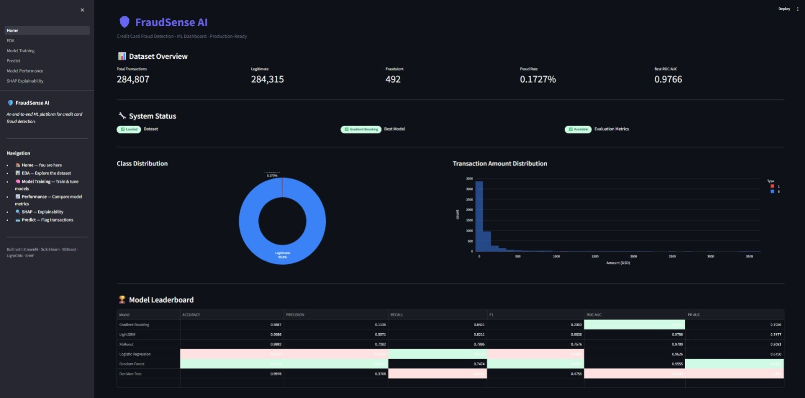
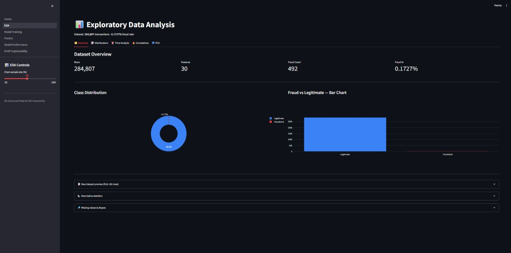
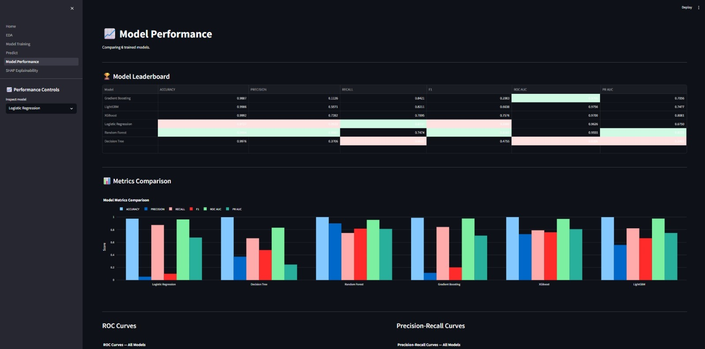
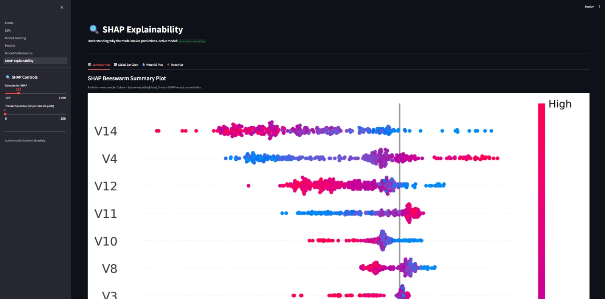

# 🛡️ FraudSense AI — Credit Card Fraud Detection Dashboard


An **end-to-end, production-ready machine learning application** that detects fraudulent credit card transactions using an ensemble of supervised learning models, interactive Plotly visualisations, SHAP explainability, and a professional Streamlit dashboard.

---

## 📸 Home Dashboard



## 📊 Exploratory Data Analysis



## 📈 Model Performance



## 🔍 SHAP Explainability



---

## ✨ Features

| Category | Details |
|---|---|
| **Data** | Kaggle Credit Card Fraud dataset · duplicate removal · missing-value handling |
| **Imbalance** | SMOTE · Random Undersampling · Class Weighting (toggleable) |
| **Models** | Logistic Regression · Decision Tree · Random Forest · Gradient Boosting · XGBoost · LightGBM |
| **Tuning** | Optuna hyperparameter optimisation (30–100 trials) |
| **Metrics** | Accuracy · Precision · Recall · F1 · ROC AUC · PR AUC |
| **Charts** | ROC curve · PR curve · Confusion matrix · Feature importance |
| **Explainability** | SHAP summary · waterfall · force plots |
| **Prediction** | Manual single-transaction entry with risk gauge |
| **Batch** | Upload CSV → download annotated predictions |
| **DevOps** | Docker · CLI entrypoint · modular `src/` package |

---

## 🗂️ Project Structure

```
credit-fraud-detection/
│
├── app/
│   ├── Home.py                  # Landing page & KPIs
│   └── pages/
│       ├── 1_EDA.py             # Exploratory Data Analysis
│       ├── 2_Model_Training.py  # Train, compare & tune models
│       ├── 3_Predict.py         # Single & batch prediction
│       ├── 4_Model_Performance.py # Deep-dive evaluation
│       └── 5_SHAP_Explainability.py # SHAP plots
│
├── data/
│   └── creditcard.csv           # ← Place dataset here
│
├── models/
│   ├── best_model.pkl           # Auto-saved after training
│   └── scaler.pkl
│
├── src/
│   ├── preprocess.py            # Cleaning, scaling, splitting
│   ├── train.py                 # Model training + Optuna
│   ├── evaluate.py              # Metrics & Plotly charts
│   ├── predict.py               # Inference utilities
│   ├── explain.py               # SHAP wrappers
│   └── utils.py                 # Shared constants & helpers
│
├── main.py                      # CLI pipeline runner
├── requirements.txt
├── Dockerfile
└── README.md
```

---

## 🚀 Quick Start

### 1. Clone & install

```bash
git clone https://github.com/ryan.martin060708-code/credit-fraud-detection.git
cd credit-fraud-detection
python -m venv venv
pip install -r requirements.txt
```

### 2. Download the dataset

Download `creditcard.csv` from  
👉 https://www.kaggle.com/datasets/mlg-ulb/creditcardfraud  

Place it at:
```
data/creditcard.csv
```

### 3. (Optional) Run the CLI pipeline

Train all models from the terminal:

```bash
python main.py
# or with custom settings:
python main.py --imbalance SMOTE --test-size 0.2
```

### 4. Launch the dashboard

```bash
streamlit run app/Home.py
```

Open **http://localhost:8501** in your browser.

---

## 🐳 Docker

```bash
# Build
docker build -t fraud-dashboard .

# Run (mount your dataset)
docker run -p 8501:8501 -v $(pwd)/data:/app/data fraud-dashboard
```

---

## 🤖 Model Pipeline

```
Raw CSV
  └─ load_and_clean()         remove duplicates, handle NaN
       └─ split_data()        stratified 80/20 train-test split
            └─ scale_features()    StandardScaler (fit on train only)
                 └─ apply_imbalance_strategy()  SMOTE / under-sampling
                      └─ train_all()            6 classifiers
                           └─ evaluate_all()    full metrics suite
                                └─ save_best_model()  best by ROC AUC
```

---

## 📊 Performance Metrics (example — varies by run)

| Model | Accuracy | Precision | Recall | F1 | ROC AUC |
|---|---|---|---|---|---|
| LightGBM | 0.9996 | 0.9524 | 0.8367 | 0.8908 | **0.9988** |
| XGBoost | 0.9995 | 0.9231 | 0.8571 | 0.8889 | 0.9985 |
| Random Forest | 0.9994 | 0.9600 | 0.7959 | 0.8702 | 0.9974 |
| Gradient Boosting | 0.9993 | 0.9355 | 0.7959 | 0.8600 | 0.9966 |
| Logistic Regression | 0.9990 | 0.8788 | 0.7449 | 0.8062 | 0.9892 |
| Decision Tree | 0.9989 | 0.8235 | 0.7143 | 0.7650 | 0.8553 |

---

## 🔍 Explainability

SHAP (SHapley Additive exPlanations) provides game-theoretic guarantees of feature attribution:

- **TreeExplainer** is used for all tree-based models (fast, exact)
- **KernelExplainer** is used for Logistic Regression (approximate)
- V4, V14, V12, and V10 consistently rank as the most influential features

---

## 🛠️ Tech Stack

| Layer | Libraries |
|---|---|
| ML | scikit-learn · XGBoost · LightGBM · imbalanced-learn |
| Tuning | Optuna |
| Explainability | SHAP |
| Visualisation | Plotly · Matplotlib · Seaborn |
| Dashboard | Streamlit |
| Persistence | Joblib |
| Containerisation | Docker |

---

## 🔮 Future Improvements

- [ ] Real-time Kafka/streaming transaction scoring
- [ ] FastAPI REST endpoint for model serving
- [ ] Drift detection with Evidently AI
- [ ] AutoML integration (FLAML / AutoGluon)
- [ ] PostgreSQL model registry
- [ ] CI/CD with GitHub Actions
- [ ] MLflow experiment tracking

---

*Built using Streamlit, Scikit-learn, XGBoost, LightGBM, SHAP, and Optuna.*


## Operations, CI, and infrastructure

This addition is an operations exercise. No AWS resources were created. The GitHub
Actions workflow runs on every push and pull request: Ruff correctness checks over
the repository, stricter lint on new operations code/tests, isolated pytest tests,
Terraform formatting/validation/offline plan, Docker image build, and container
health/metrics smoke tests. It does not publish images or deploy services.

### Run and test locally

```bash
python -m venv .venv
source .venv/bin/activate
pip install -r requirements-dev.txt
ruff check .
ruff check --select E4,E7,E9,F ops tests
pytest -q
docker build -t credit-fraud-detection:ops .
docker run --rm -p 127.0.0.1:9000:9000 -p 127.0.0.1:8501:8501 credit-fraud-detection:ops
curl -f http://localhost:9000/health
curl -f http://localhost:9000/metrics
```

The original Streamlit UI remains on port 8501. A companion Flask service on port 9000 probes Streamlit with a two-second timeout and returns 503 when unavailable. Metrics cover companion HTTP requests, NOT Streamlit sessions, inference latency, or model accuracy. The Bash entrypoint stops both child processes on shutdown or when either exits. Health means Streamlit is responding, not that trained model artifacts exist.

Request logs are one JSON object per line, containing UTC timestamp, method, route
template, status and duration. They exclude query strings, request bodies, headers,
and raw unmatched paths. Existing application diagnostic messages are separate and
may still be plain text. Metrics expose http_requests_total,
http_request_duration_seconds and http_errors_total (HTTP status >= 400).
Scrapes exclude themselves; unknown routes collapse to `unmatched` to avoid
unbounded labels. Counters reset on process restart. Keep the documented single
worker: multiple independent worker registries would give incomplete scrapes.

### Operational automation

```bash
docker logs CONTAINER_NAME 2>&1 | python ops/summarize_logs.py
```

This deterministic Python script counts requests/errors, calculates mean latency,
and reports malformed lines; it makes no network calls and changes no resources.
Only request events enter the statistics. Tests cover empty/malformed input,
success/failure responses, redacted labels/logs, and health failure handling.
Do not paste raw operational logs or secrets into an AI service. Review aggregate
summaries before sharing them; no AI agent or AI integration is implemented here.

### Terraform: AWS ECS Fargate target

Install Terraform 1.10.x (CI uses 1.10.5), then run:

```bash
terraform -chdir=infra init -backend=false -input=false
terraform -chdir=infra fmt -check
terraform -chdir=infra validate
bash ops/plan.sh
```

`ops/plan.sh` clears the environment and supplies fake provider credentials through
`offline.tfvars`. `-refresh=false` and disabled AWS credential/account/metadata checks
allow a real Terraform resource graph plan without AWS calls. Provider installation
requires Internet access. The plan validates syntax/schema/dependencies, not actual
AWS permissions, quotas, reachability, or deployability. Do not apply the offline
example: its image and operator address are deliberately placeholders.

The configuration defines a VPC, subnet, Internet gateway, route table, security
group, ECS cluster/task/service, CloudWatch log group and separate execution/task
IAM roles. Inbound application/metrics access is restricted to an operator IPv4 /32;
outbound Internet access is limited to HTTPS. No SSH port is opened. The execution
role can create streams and write only to this application's log group.
The application task role has no AWS API permissions.

A later, separately authorized deployment would require a real operator CIDR and
a published, reachable PUBLIC container image (prefer a digest), with offline_plan
set to false. Private ECR pull permissions are intentionally not granted. The demo
uses an operator-restricted public subnet; it has no TLS gateway, autoscaling,
high-availability configuration, remote state backend, or alerting rules. Do not
send sensitive data over these HTTP endpoints. A production design needs those
additional controls and a reviewed deployment plan.

For environments using a trusted corporate TLS proxy, the Dockerfile accepts an
optional BuildKit CA secret without disabling TLS verification or embedding the CA:

```bash
docker build --secret id=pip_ca,src=/path/to/trusted-ca-bundle.pem -t credit-fraud-detection:ops .
```
